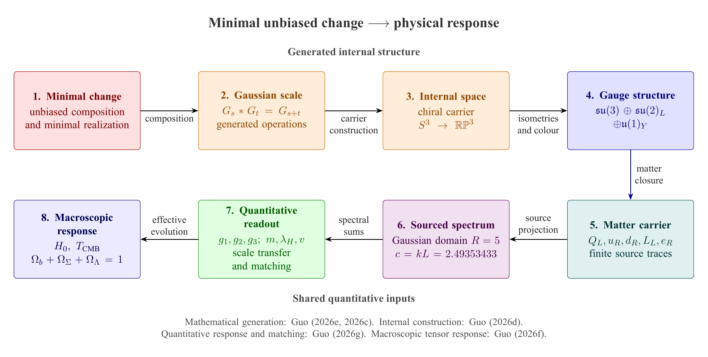

# Coarse-Graining Genesis Framework

## Reproducible physics from a common generating source

[](https://doi.org/10.5281/zenodo.22067005)

**Jinku Guo · Northwestern Polytechnical University**

[Research portal](https://bookwormseagull1980.github.io/Book-and-Articles/) ·
[Reviewer guide](REVIEWER_START_HERE.md) · [Release facts](docs/RELEASE_FACTS.md) ·
[Complete technical reference](REFERENCE.md) · [Discussions](https://github.com/bookwormseagull1980/coarse-graining-genesis/discussions)

V5 is the executable numerical branch of a mathematical-physics programme
starting from minimal unbiased compositional change. It follows one source
record through compact spectral geometry, gauge-matter response, effective
couplings, mass scales, emergent gravity and cosmological observables.

The companion paper on [effective couplings and mass scales](https://arxiv.org/abs/2607.24329)
is available as **arXiv:2607.24329**, [DOI 10.48550/arXiv.2607.24329](https://doi.org/10.48550/arXiv.2607.24329).

The current record contains **261 derived records** and **57 named benchmark comparisons**. Of the 56 central-value comparisons, **51 are within 1%** of the adopted references. Results include three fermion generations, linked mass relations, gauge couplings, neutrino masses and cosmological abundances. [Explore the numerical results](#numerical-results-across-particle-physics-and-cosmology).

The distinctive feature is the common input structure. Several outputs depend
on the same finite spectral response and normalization, so a source change
propagates across sectors in a reproducible way. The code retains those
dependencies, the finite response domain, interval enclosures and comparison
data. The companion [Lean library](https://github.com/bookwormseagull1980/Lean-Formalization-of-Arithmetic-and-Basic-Physical-Interfaces)
gives the formal source construction and the generated Yang-Mills operator
theorems.



## Main calculations and results

| Sector | Result or construction | Where to examine it |
| --- | --- | --- |
| Spectral response | Selected level R=5 and an exact eight-branch response reduction; a unique TT endpoint near 2.49353433 | [Structural closure](docs/STRUCTURAL_CLOSURE.md), [TT equivalence](docs/TT_EQUIVALENCE.md) |
| Gauge and matter | Common-source gauge-matter bundle, scalar response and effective-coupling readouts | [Framework ledger](docs/V5_LEDGER.md) |
| Generated Yang-Mills gap | TT-endpoint generated gap, its relation to the formal IR-edge operator and the separate low-energy effective readout | [Lean correspondence](docs/LEAN_CORRESPONDENCE.md) |
| Mass relations and matching | A charged-lepton relation in the six-fermion geometric setting, finite matching and mass-scale propagation | [Papers index](docs/PAPERS.md), [technical reference](REFERENCE.md) |
| Gravity | Source-to-readout tensor response with the retained direct term and source/binding contributions | [Scientific overview](docs/papers_overview.pdf), [framework ledger](docs/V5_LEDGER.md) |
| Cosmology | Expansion and structure readouts, thermal and abundance calculations, with separately recorded observational comparisons | [Release facts](docs/RELEASE_FACTS.md), [precision budget](docs/PRECISION_BUDGET.md) |

### One input record, correlated physical outputs

The finite response-domain calculation has a selected level and a certified
endpoint enclosure. The same record enters effective couplings, matter scales
and macroscopic readouts. This gives a concrete way to test cross-sector
compatibility: change a generating quantity once, propagate its dependencies,
and examine the joint response.

The programme retains the action evaluated on the generated fields and the
difference between a complete response and a radial replacement. Finite windows
also retain memory, source moments and return from eliminated degrees of
freedom. The [full reference](REFERENCE.md) explains these mechanisms and their
numerical consequences.

### Generated Yang-Mills and radius realizations

The formal IR-edge model has a source-generated nonlinear curvature action,
a complete original-field differential Hessian, a unique self-adjoint closure
and an attained positive spectral bottom. V5 evaluates the separate
transverse-traceless endpoint realization. Its enclosure and exact finite-branch
reduction provide the numerical interface to the corresponding Lean endpoint
certificate.

The Gaussian IR edge and the TT endpoint are different radius realizations.
The generated gap and the low-energy glueball catalogue are also different
readouts. Their source definitions, dimensions and comparison roles are
specified in [the correspondence document](docs/LEAN_CORRESPONDENCE.md).

## Numerical results across particle physics and cosmology

V5 computes a linked set of particle and cosmological quantities from the programme's common spectral construction. The current numerical record contains **262 parameter records: 261 derived records and one measured dimensional anchor, Newton's constant**. The records preserve the generating dependencies and the readout prescriptions used to obtain each quantity.

The benchmark programme contains **57 named comparisons**, comprising **56 central-value comparisons and one upper-limit test**. Among the 56 central-value rows:

| Absolute relative difference from the adopted reference | Number of comparison rows |
| --- | ---: |
| Below 1% | **51 / 56** |
| Below 0.5% | **40 / 56** |
| Below 0.1% | **13 / 56** |

The counts follow the named comparison rows, including alternative approximations, reciprocal mass ratios and geometric-mass diagnostics. Each comparison retains its reference, scale and mass convention. The percentage measures the difference between central values; experimental and theoretical uncertainties are reported with the individual observables.

The common calculation selects **three fermion generations**, **R = 5**, and a tensor endpoint **kL ≈ 2.49353433**. The three matched high-energy gauge couplings agree with the adopted Standard Model extrapolations to within **0.003%**. Representative low-energy outputs include **αₛ(MZ) = 0.118041**, an electroweak scale of **246.190 GeV**, a Z mass of **91.12484 GeV**, and a tree-level Higgs mass of **124.98344 GeV**. The corresponding central-value residuals are approximately **+0.120%, −0.012%, −0.069% and −0.173%**.

The neutrino branch gives normal ordering with a summed mass of **0.0614785 eV**. Cosmological outputs include **ΩΛ = 0.685044**, **Ωb = 0.0494082**, a cold-component fraction of **0.264039**, **T₍CMB₎ = 2.725474 K**, and a baryon-to-photon ratio of **6.12823 × 10⁻¹⁰**. Structure readouts give **σ₈ = 0.81233** and **S₈ = 0.83226**. The tensor ratio is **r = 0.0253303**, below the adopted bound of **0.036**.

Seven groups of observable tests in the companion mass-and-coupling paper connect these calculations to neutrino ordering and mixing, primordial tensors, glueball spectroscopy and low-acceleration gravity. The repository also retains the full comparison record, including the **−7.23%** solar rest-splitting residual, the **+4.23%** neutron-lifetime residual, and the DESI DR2 result **χ² ≈ 29.51 for 13 components**. The breadth of the calculation makes both agreement and disagreement constrain a common construction.

[The full benchmark record](docs/benchmark-summary.json) gives the named rows, references and residuals. The comparison can be reproduced with the repository's [parameter audit](comparison/param_audit_full.py).

## Run a first calculation

The standard-library spectral example supplies a small, inspectable result:

```sh
python examples/quickstart/run_example.py
python scripts/certify_tt_response.py
```

The first command generates a three-shell scalar record on the projective
carrier and checks its output. The second computes the finite response-domain
endpoint certificate and the selected integer level.

For the core regression suite:

```sh
python -m pip install -r requirements-lock.txt
python -m pytest -q -m "not numerical and not auxiliary" -p no:cacheprovider
```

The lock file records the tested Python 3.13.12 environment.
[requirements.txt](requirements.txt) gives compatible lower bounds for ordinary
installation. The [reviewer guide](REVIEWER_START_HERE.md) gives the full release
reproduction, including audits and the optional cosmology calculations.
The [Actions page](https://github.com/bookwormseagull1980/coarse-graining-genesis/actions)
shows current branch regression runs.

## Reading a numerical record

The current release-facts document identifies run
`20261025T021453Z-a4c66902`: 262 parameter records, 261 derived records and
zero pending records. It records 648 passing CI-core tests from a separate
run; the full suite was not rerun for that record. These figures describe the
named record and are kept in [docs/RELEASE_FACTS.md](docs/RELEASE_FACTS.md).

A derived quantity, an interval certificate and an observational statistic
answer different questions. The source ledger states how a quantity is
constructed. A certificate encloses its specified calculation. A comparison
uses the stated observed inputs, covariance and matching scheme. The release
records keep these layers separate so that a successful check has a precise
scientific meaning.

For example, the cosmological record includes sigma_8 near 0.81233 and S_8 near
0.83226. The precision budget explains the associated input and finite-window
information. The complete technical reference retains the numerical discussion,
including comparisons that reveal tensions and their physical remainder.

## Documentation and companion work

- [Scientific graphical overview](docs/papers_overview.pdf) introduces the common
  source, geometry, response, matching and macroscopic layers.
- [Papers index](docs/PAPERS.md) links the companion manuscripts.
- [Framework ledger](docs/V5_LEDGER.md) traces the physical construction and inputs.
- [Precision budget](docs/PRECISION_BUDGET.md) describes endpoint and abundance errors.
- [Structural closure](docs/STRUCTURAL_CLOSURE.md) and
  [TT equivalence](docs/TT_EQUIVALENCE.md) specify the certificate interfaces.
- [Lean correspondence](docs/LEAN_CORRESPONDENCE.md) maps numerical and formal results.
- [Complete technical reference](REFERENCE.md) preserves the full research
  introduction, mechanisms and detailed results.

The [shared research portal](https://bookwormseagull1980.github.io/Book-and-Articles/)
connects these calculations with generated arithmetic, prime operators,
long-range response and certified computation. All reading copies and their
individual DOIs are in
[Book-and-Articles](https://github.com/bookwormseagull1980/Book-and-Articles).

## Citation and scientific feedback

Cite V5 using its concept DOI,
[10.5281/zenodo.22067005](https://doi.org/10.5281/zenodo.22067005),
and the companion paper for the result being used.
[CITATION.cff](CITATION.cff) contains the software metadata.
[LICENSE](LICENSE) states the copyright and attribution requirements.

Use [Discussions](https://github.com/bookwormseagull1980/coarse-graining-genesis/discussions)
for mathematical or physical questions. A reproducibility issue should identify
the command, source revision, environment and affected record; the issue form
provides space for these details.

Subjects: computational physics, generated gauge structure, Yang-Mills mass
gap, Standard Model, spectral geometry, effective couplings, electroweak
matching, emergent gravity, cosmology, validated numerics and interval arithmetic.

## Research subjects and results

### Primary subjects

Computational physics; Standard Model; Yang-Mills theory; Mass gap; Gauge coupling constants; Fermion masses; Higgs physics; Emergent gravity; Cosmology; Spectral methods; Validated numerics; Reproducible research.

### Research subjects

Gauge theory; Chiral matter; Fermion generations; Mass hierarchies; Charged lepton masses; Electroweak scale; Electroweak matching; Higgs mass; Top quark decay; Spectral geometry; Gravitational response; Cosmic expansion; Matter power spectrum; Structure growth; Primordial abundances.

### Methods

Scientific computing; Numerical analysis; Interval arithmetic; Error propagation; Spectral tail bounds; Numerical quadrature; Root finding; Spectral truncation; One-loop calculations; Parameter dependence; Automated testing; Computational reproducibility; Python; Numerical certificates; Reference-data comparison.

### Results and research questions

Reproducible calculations of gauge couplings and mass scales; Generated Yang-Mills spectral gap; Unique transverse-traceless endpoint with numerical enclosure; Correlated fermion mass relations; Electroweak matching from a common spectral source; Coupled particle and cosmological observables; Certified spectral tails and quadrature errors; Reproducible matter-clustering amplitudes sigma8 and S8.

### Chinese subject terms

计算物理; 标准模型; 杨米尔斯质量间隙; 规范耦合; 费米子质量; 电弱匹配; 希格斯物理; 涌现引力; 宇宙学; 区间算术; 可复现研究; 数值认证.
